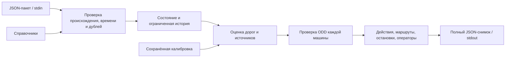

# Архитектура

## Поток обработки

## Границы компонентов

- `solution/solution.py` содержит исходный алгоритм, класс `Controller` и CLI.
  При реорганизации алгоритм сохранён побайтно.
- `solution/__main__.py` даёт точку входа `python -m solution`;
  `solution/__init__.py` экспортирует `Controller` и `stamp` для инструментов.
- `weather_groups.json` и `calibration.json` лежат рядом с реализацией:
  это параметры runtime, которые должны версионироваться вместе с кодом.
- `tools/` работает с внешними наборами данных: считает метрики, проверяет
  причинный обмен пакетами, обучает калибровку и записывает данные демо.
  Команды запускаются как `python -m tools.<имя>` из корня проекта.
- `tests/` отделён от runtime. Тесты на данных явно пропускаются, если набор
  организатора недоступен. Автономные тесты запускаются и в CI.
- `demo/` — статический просмотр записанных решений. Разметка в нём служит
  пояснениям и не передаётся контроллеру.
- `docs/` хранит описание решения и исторические результаты проверки.

## Состояние и ограничения

Один процесс обслуживает один сценарий. Между пакетами сохраняются последние
наблюдения, ограниченная история, идентификаторы дублей и прошлые действия.
Следующий пакет можно подавать после получения полного ответа на предыдущий;
этот режим проверяет `tools/lockstep.py`. Случайности и сетевых вызовов в runtime нет.

Контроллер проверяет происхождение событий, свежесть, допустимость движения,
ODD, направленную связность маршрута, массу и вместимость площадок и пул
дистанционной поддержки. При нехватке допустимых вариантов выбирается HOLD.
Подробности алгоритма и известные ограничения приведены в [REPORT.md](REPORT.md).

## Сборка и артефакты

Dockerfile копирует только `solution.py` и два JSON-файла в `/app`, использует
зафиксированный digest базового образа и непривилегированного пользователя.
Справочники подключаются томом только для чтения. `build.sh` собирает образ,
не создавая TAR или ZIP.

Данные организатора (`data/`), новые результаты (`results/`), обученные варианты
(`fitted/`) и кэши исключены из Git. Готовая демонстрация и презентации включены,
чтобы проект можно было показать сразу после клонирования.

Старые ZIP-архивы, Docker TAR, готовые PUBLIC-ответы, упаковочные скрипты,
паспорт старого образа и контрольные суммы прежнего комплекта в репозиторий
не перенесены. Исходный комплект сохранён отдельно перед реорганизацией.
